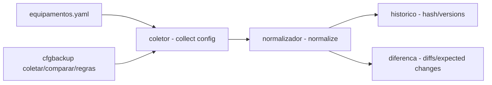

# config-backup-switches

**English** · [Português (Brasil)](README.md)

[](#) [](#) [](#) [](LICENSE)

## What it is

**Switch configuration backup** with **hash-based change detection** and **normalization before comparison**: it collects the configured state of devices (a YAML list), builds a versioned history, **normalizes** the configs and **compares** snapshots pointing out diffs and expected changes. It is an educational network-automation lab in Python.

## Status

An educational lab, working and tested (139 tests).

## Features

- **Collection** (`coletor.py`, `simulador.py`): reads the device list (YAML), collects the config and builds the history.
- **Normalization** (`normalizador.py`): standardizes lines before comparison; a rules table.
- **Hash detection**: compares configs by hash to detect changes.
- **History** (`historico.py`): keeps versions of the collected configs.
- **Diff** (`diferenca.py`): highlights differences between snapshots, with expected changes (expirable by date).
- **CLI**: `cfgbackup coletar --equipamentos ... --saida ...`, `comparar`, `regras` (normalization table).

## Architecture

A `cfgbackup` package with `coletor` (collection), `normalizador` (normalization), `diferenca`/`historico` (compare/version) and `simulador` (config source), orchestrated by the CLI.



## Stack

- Python ≥ 3.10
- PyYAML ≥ 6.0 (only dependency)
- pytest (dev)

## Repository layout

```
config-backup-switches/
├── pyproject.toml · BRIEF.md
├── src/cfgbackup/
│   ├── coletor.py · simulador.py · normalizador.py
│   ├── historico.py · diferenca.py · cli.py
├── dados/equipamentos.yaml
├── tests/             # 139 tests
└── LICENSE            # MIT
```

## Prerequisites and installation

Python ≥ 3.10.

```bash
pip install -e .
```

## How to run

```bash
cfgbackup coletar --equipamentos dados/equipamentos.yaml --saida saida/   # collect + history
cfgbackup comparar --anterior saida/a --atual saida/b --esperadas mudancas.yaml   # diffs
cfgbackup regras                                                          # normalization table
```

## Tests and quality

Real command (verified by the agent):

```bash
PYTHONPATH=src python -m pytest tests/
# 139 passed
```

## Technical decisions and trade-offs

- **Normalize before comparing**: avoids false diffs from formatting differences; the cost is a rules table to maintain.
- **Hash detection**: fast and precise change detection.
- **Expected changes with validity**: distinguishes drift from a planned/declared change.

## Known limitations and roadmap

- Configs come from a simulator (not real switches over SSH/API).
- Normalization covers the defined rules; off-pattern configs may produce spurious diffs.

## Development process

An individual project by Kelvin Oliveira, built with orchestrated AI agents and reviewed by the author. The backup/normalization pipeline and the review are the author's.

## License and author

MIT — Copyright (c) 2026 Kelvin Rebelo de Oliveira.

**Author**: [Kelvin Oliveira](https://github.com/KelvinOliveiraCode) · [Portfolio](https://kelvinoliveiracode.github.io/portfolio/)
