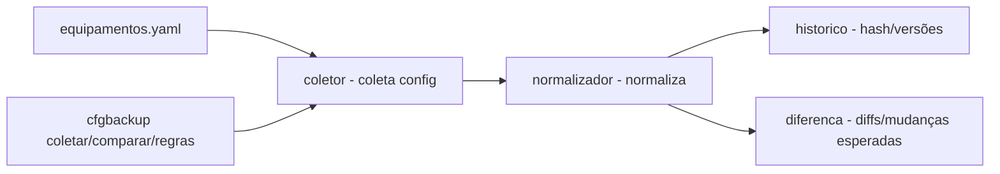

# config-backup-switches

[English](README.en.md) · **Português (Brasil)**

[](#) [](#) [](#) [](LICENSE)

## O que é

**Backup de configuração de switches** com **detecção por hash** e **normalização antes de comparar**: coleta o estado configurado dos equipamentos (lista em YAML), gera um histórico versionado, **normaliza** as configs e **compara** coletas apontando diffs e mudanças esperadas. É um laboratório educacional de automação de redes em Python.

## Status

Laboratório educacional funcional e testado (139 testes).

## Funcionalidades

- **Coleta** (`coletor.py`, `simulador.py`): lê a lista de equipamentos (YAML), coleta a config e monta o histórico.
- **Normalização** (`normalizador.py`): padroniza linhas antes de comparar; tabela de regras.
- **Detecção por hash**: comparação de configs por hash para detectar mudança.
- **Histórico** (`historico.py`): mantém versões das configs coletadas.
- **Diff** (`diferenca.py`): aponta diferenças entre coletas, com mudanças esperadas (expiradas por data).
- **CLI**: `cfgbackup coletar --equipamentos ... --saida ...`, `comparar`, `regras` (tabela de normalização).

## Arquitetura

Pacote `cfgbackup` com `coletor` (coleta), `normalizador` (normaliza), `diferenca`/`historico` (compara/versiona) e `simulador` (fonte de config), orquestrados pelo CLI.



## Stack

- Python ≥ 3.10
- PyYAML ≥ 6.0 (única dependência)
- pytest (dev)

## Estrutura do repositório

```
config-backup-switches/
├── pyproject.toml · BRIEF.md
├── src/cfgbackup/
│   ├── coletor.py · simulador.py · normalizador.py
│   ├── historico.py · diferenca.py · cli.py
├── dados/equipamentos.yaml
├── tests/             # 139 testes
└── LICENSE            # MIT
```

## Pré-requisitos e instalação

Python ≥ 3.10.

```bash
pip install -e .
```

## Como executar

```bash
cfgbackup coletar --equipamentos dados/equipamentos.yaml --saida saida/   # coleta + histórico
cfgbackup comparar --anterior saida/a --atual saida/b --esperadas mudancas.yaml   # diffs
cfgbackup regras                                                          # tabela de normalização
```

## Testes e qualidade

Comando real (verificado pelo agente):

```bash
PYTHONPATH=src python -m pytest tests/
# 139 passed
```

## Decisões técnicas e trade-offs

- **Normalizar antes de comparar**: evita falsos diffs por diferenças de formatação; o custo é uma tabela de regras a manter.
- **Detecção por hash**: comparação rápida e precisa de mudança.
- **Mudanças esperadas com validade**: diferencia drift de mudança planejada/declarada.

## Limitações conhecidas e roadmap

- As configs vêm de um simulador (não de switches reais via SSH/API).
- A normalização cobre as regras definidas; configs fora do padrão podem gerar diffs espúrios.

## Processo de desenvolvimento

Projeto individual de Kelvin Oliveira, construído com agentes de IA orquestrados e revisado pelo autor. O pipeline de backup/normalização e a revisão são do autor.

## Licença e autor

MIT — Copyright (c) 2026 Kelvin Rebelo de Oliveira.

**Autor**: [Kelvin Oliveira](https://github.com/KelvinOliveiraCode) · [Portfólio](https://kelvinoliveiracode.github.io/portfolio/)
